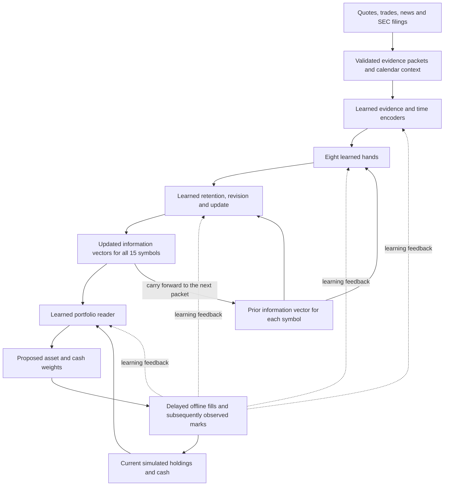

# TALG: evidence preparation and continuous information model

Technical design and implementation status, 11 October 2026.

This document focuses on the preparation stage: how raw market observations, news and filings become time-ordered evidence packets, and how the model will use those packets to maintain information and learn. It describes the implemented training path; it is not a report of trained trading performance.

TALG maintains a persistent information vector for each market symbol. New evidence changes that vector through learned update proposals called **hands**. A separate learned portfolio reader considers all current symbol vectors and the portfolio together, then proposes an allocation. Learning from later observed portfolio outcomes updates both the reader and the information model.

The research question is whether this shared, continuously updated representation can preserve useful context and support better portfolio decisions. The current system implements the data pipeline, neural blocks, simulator, joint trainer, and recovery mechanisms. Synthetic tests demonstrate working gradients and checkpoint restoration; real-market trading effectiveness remains unevaluated.

This guide describes the current local implementation. This release contains the documentation and summarized engineering evidence; the newer implementation, model checkpoints and runtime data are not included. The existing public source describes earlier TALG experiments. The active local information model has no stock-price prediction head, volatility prediction head, or forecast-label objective.

## The arrow and hands idea

The **arrow** is a metaphor for the model's current understanding of a symbol. It can contain information about price behavior, news, market conditions, timing, and earlier evidence. Coordinates have no predefined semantic labels; training determines how they encode evidence. There is no assigned coordinate for optimism, acceleration, or a buy signal.

A **hand** is a learned proposal to change that understanding. It reads the incoming evidence and the existing vector, then proposes an update in the same information space. The updater decides what to retain, what to revise, and what new information to incorporate.

This implements the original intuition of several influences pushing an established state. It does not require a hand-written formula connecting every observation to a stock forecast. The neural computation is explicit in the source, while the interpretation of evidence is learned.

The portfolio reader gives that representation a practical learning objective. A positive-looking coordinate does not automatically cause a purchase: the reader learns how the full collection of vectors relates to the portfolio decision.

## Preparation: from sources to a usable training day

Preparation builds the evidence the model will learn from. Downloading a source, sealing a packet and completing a learning update are different milestones.

| Step | What happens | Result to inspect |
| --- | --- | --- |
| 1. Fix the historical plan | Save the 15-symbol basket, date range, exchange calendar, source settings and exact model dependencies | A pinned job that resumes with the same definitions |
| 2. Collect the evidence | Retrieve quotes, trades, news article versions and SEC filing material; retain compressed source pages and checksums | Resumable archives and source coverage records |
| 3. Normalize and establish availability | Convert source records into a common receipt contract, identify their symbol and source, and record observed and assumed available times | Traceable receipts that can be assigned to a historical cutoff |
| 4. Route quality problems | Validate structure, deduplicate retransmissions, quarantine invalid records and retain uncertainty flags on usable evidence | Quality decisions alongside the original receipts |
| 5. Build the timeline | Seal the closure packet five minutes before the open, then build five-second packets through the close | A linked packet sequence for each symbol, with all five sections and actual interval durations |
| 6. Verify the completed day | Finish every symbol, check expected packet counts, close the databases, hash them and verify unchanged source receipts and archive pins | A saved completion record eligible for the trainer's input checks |
| 7. Hand off and retain recovery data | Learn from a bounded batch of complete days; verify checkpoints and actual optimizer updates before reclaiming expanded databases | Saved models and symbol memories, with compressed source archives retained |

The five packet sections are quotes, trades, news, market/sector context and day-so-far context. They share a cutoff: the packet must not contain evidence from after its own information boundary. SEC material is identified within the news section. A quiet source, a missing source and a malformed record require different handling; missing content is never filled with invented news or prices.

News and SEC collection can have declared gaps under the selected rolling policy. Those gaps stay in the collection records. Corrupted or missing required market archives still fail preparation. Source-only completion means that archives were collected; it does not mean that the packet sequence is ready or that a model has learned.

Four construction workers currently build different symbol databases in parallel. A complete training frame still requires the aligned set of all 15 symbols. The rolling buffer holds up to three complete days so the system can prepare, learn and reclaim expanded storage without first building the whole year.

The preparation panel should be read in those same stages: source coverage, packets sealed, complete days, actual learning/checkpoint progress, and storage. A moving collection or packet counter establishes preparation progress. Actual optimizer updates and saved training checkpoints establish learning progress.

A saved learning configuration alone is not input readiness. Before fitting, the trainer also checks the completed days, source-gap policy, packet counts, database hashes and SEC provenance. Even a verified packet sequence can contain missing prices: it guarantees the packet contract, while usable trading marks and later portfolio changes determine whether a learning opportunity exists.

## How a packet will move through the model

Consider a regular-session packet ending at 10:00:05 New York time. For each symbol, it contains evidence eligible before that cutoff, plus summaries and carried context. The following is a walkthrough of the implemented path, not a claimed learned behavior:

1. **Encode the packet.** Source encoders transform numeric fields, missingness and bounded text into tokens. A separate learned encoder adds date, time, phase and duration context.
2. **Read the existing memory.** The symbol brings forward its prior information vector. On its first packet, a learned initializer creates that state from evidence.
3. **Propose changes.** Eight hands examine the tokens and the same prior vector. Each proposes a 512-dimensional change and a strength. A hand's role is learned; there is no fixed rule that assigns one hand to news or makes favorable words produce a buy.
4. **Update the next vector.** The learned updater combines the proposals with retention and revision. This vector becomes the prior for the next packet; durable training checkpoints are saved after complete days.
5. **Read the portfolio opportunity.** After all 15 vectors reach 10:00:05, and if the required current price marks are usable, the reader considers the vectors together with simulated holdings and cash, then proposes asset and cash weights.
6. **Observe consequences and learn.** The simulator can fill that proposal at the next valid scheduled mark, 10:00:10; otherwise it cancels it. Only movement after that fill contributes to its outcome. Feedback accumulated in a training window updates the reader and the information blocks together.

The vector changes with each packet even between optimizer updates. An optimizer update changes the shared rules for interpreting future packets; it is separate from the per-symbol memory update. Consequently, experience from one symbol can improve the shared model while its particular news and history remain in that symbol's own state.

## Overall flow

Each symbol has its own vector. The information model's weights are shared across symbols. The reader sees all updated vectors at the same historical cutoff, so it never compares one symbol's morning state with another symbol's later-day state.

## Block inputs and outputs

| Block | Input | Output | Learning responsibility |
| --- | --- | --- | --- |
| Collection and packaging | Timestamped source records, source mappings and exchange calendar | Immutable packets, receipt references and coverage records | Deterministic data handling |
| Evidence quality | Record structure, source flags, missingness and timing | Accepted, flagged, duplicate or quarantined decisions | Structural checks are active; optional quality classifier is separate and currently unfitted |
| Evidence and calendar encoders | Packet summaries, selected receipts, text, missingness and time | Evidence tokens in a common representation | Jointly trained with the reader |
| State initializer | The first packet's encoded evidence | Initial symbol information vector | Jointly trained |
| Hand maker | Current tokens and the same prior vector for every hand | Eight vector proposals and strength logits | Jointly trained |
| State updater | Prior vector and the complete set of proposals | Next vector and update diagnostics | Jointly trained |
| Session transition | Carried vector and elapsed calendar interval | State conditioned on the transition into the next session | Jointly trained |
| Portfolio reader | All symbol vectors, availability and current portfolio context | Proposed long-only asset weights and cash weight | Jointly trained |
| Simulator and checkpointing | Proposals, later observed marks and training state | Portfolio outcomes, metrics and resumable checkpoints | Fixed accounting and persistence rules |

Only the representation and reader have parameters updated by the joint optimizer. Gradients pass through the simulator's fixed differentiable accounting. Collection, packet boundaries, checksums and checkpoint rules remain deterministic.

## Evidence packets

Every packet contains the same five sections. Missing sections still carry an explicit summary and coverage status.

| Section | Information supplied |
| --- | --- |
| Quotes | Observed bid and ask, displayed sizes, quote changes, spread and available feed context |
| Trades | Prints, conditions and corrections, with eligible count, volume, VWAP and high/low summaries |
| News | Article versions, available text and carried article references; SEC filings also enter this section with their source identified |
| Market and sector | Evidence from configured contextual instruments; the current basket uses SPY and QQQ and has no separate sector basket |
| Day so far | Calendar clock and session aggregates computed from evidence already available |

The envelope records symbol, session, sequence, interval, cutoff, packet identity, preceding packet identity, receipt references and pinned revisions. Sections expose freshness, missing fields, coverage, quality flags and routing counts. Collection manifests distinguish a successful empty response from a declared source gap. The current historical builder does not translate every collection gap into a packet source-health event, so packet missingness alone does not establish which occurred.

“Clean input” means a validated and inspectable contract. It does not mean that sources are complete or every observation is correct. Structurally invalid records are quarantined, exact retransmissions are deduplicated, and uncertain usable records can pass with flags. Raw receipts remain available for audit.

The current quality configuration has no fitted classifier artifact. The optional tree-model interface can flag possible corruption; it cannot reject otherwise usable evidence. It is not a news fact checker and does not learn automatically from the portfolio loss.

### What the neural model actually receives

The archive retains more detail than a single neural update consumes. Current tensorization selects up to **128 receipts per section**, with recent evidence and a reserved share of carried context. Text and typed textual context are each bounded at **512 UTF-8 bytes per token**. Omitted counts and truncation indicators remain visible.

The evidence encoders produce tokens for five source summaries and the selected receipts. A learned calendar encoder produces one additional token, which is appended before the hand maker processes them. Source references provide traceability; article IDs and URLs are not themselves neural features. Numeric features use fixed signed-log transformations and missingness indicators.

The text components are trainable byte embedding and GRU encoders initialized from scratch. They do not begin with the language understanding of a pretrained language model. Preserving full retrieved articles in the archive does not mean the model reads their entire text at every step.

## Time and causal availability

Packets use half-open intervals: an external record must have `available_at` strictly earlier than the packet cutoff to enter that packet. A record exactly on a cutoff belongs to the next interval. Sealed packets are immutable; later evidence cannot rewrite them.

Three clocks matter:

| Clock | Meaning |
| --- | --- |
| `observed_at` | Time of the market observation, article version, or filing acceptance |
| `available_at` | Time at which that evidence becomes eligible for a model packet |
| `as_of` | The packet's publication cutoff and information boundary |

The historical dataset uses **assumed availability**, currently the relevant source timestamp plus **0.25 seconds**. For revised news, the source timestamp reflects the returned version's later publication/update time. SEC evidence uses the acceptance timestamp. These are documented timing assumptions, not measurements of when a historical subscriber actually received the material.

Internal receipt bookkeeping also records the last sealed cutoff when a receipt was ingested. This protects committed history; it is not a measured historical receipt clock. Exchange-local date/time, calendar cycles, packet phase and actual interval duration are separately available to the model.

### Overnight and weekend coverage

Each market session begins with one closure packet spanning the **previous exchange close through five minutes before the next open**. Five-second packets then cover the final five preopen minutes and the regular session.

For a typical weekend, the closure packet spans **Friday 16:00 through Monday 09:25 New York time**. It is one weekend packet per symbol, rather than separate Saturday and Sunday packets. Holidays and early closes follow the pinned exchange calendar.

An ordinary full session therefore contains **4,741 packets per symbol**: one closure packet, 60 preopen packets and 4,680 regular-session packets. Session volume and similar aggregates reset at the open; the learned information vector continues.

This schedule covers the declared historical time range without pretending that a long closure interval lasts five seconds. Complete packet coverage is distinct from complete source coverage. Closing the overnight packet makes its evidence available; it does not supply a trading outcome before one has occurred.

## Persistent state and learned hands

The selected architecture uses a **512-dimensional information vector**, **eight hands**, **512-dimensional hand proposals**, and **128-dimensional evidence tokens**. Hand attention uses four heads and two layers. Every hand can address the whole information vector.

The first packet initializes the symbol state from its own evidence. Subsequent packets reuse that state. All hands read the same prior state before any update is committed, which avoids an arbitrary order in which one hand changes another hand's input.

A hand emits a bounded proposal vector and a strength logit. It is not assigned a fixed label such as “news hand” or “momentum hand”; it can attend across evidence sources. The updater lets proposals interact, combines them, and learns coordinate-wise retention, replacement content and update gates. State can be preserved, revised or expanded with new information instead of accumulating every push indefinitely.

Strengths and attention weights are inspectable diagnostics, not calibrated probabilities or verified causal explanations. Hand specialization and the usefulness of persistent memory must be measured. Matching vector widths simplifies the interface but does not guarantee lossless information transfer.

The vector is compressed learned memory. The receipt archive is the factual record. They serve different purposes, and the vector cannot be assumed to retain every historical fact.

## The portfolio reader

At each regular-session cutoff, the reader receives all 15 current vectors together with current asset weights, vector ages, cash, relative portfolio value and drawdown. Cross-asset attention produces proposed asset weights and a cash weight.

The selected allocation rules are long-only, with a **35% maximum weight per asset** and **100% maximum total investment**. Cash receives the remainder. These are explicit constraints around learned allocation, not learned claims about the best limits.

The reader's output is a proposed allocation. The active research trainer sends it to an offline differentiable simulator, not a broker. A proposal can fill only at the immediately following five-second mark if all required prices are observed; otherwise it is canceled. It starts earning subsequent movement after that fill, so it cannot profit from the interval before it could have been executed.

Portfolio value is measured from observed quote midpoints. Current configured fees, slippage, turnover penalties and drawdown penalties are all **zero**. The learning objective consequently minimizes negative log portfolio growth over each feedback window. This is learning from later observed portfolio value changes, not from a stock-price label or only completed buy/sell round trips.

The simulated portfolio starts in cash each session and is liquidated at the observed session-close mark. Information vectors continue across sessions even though portfolio holdings do not.

A usable trading mark currently requires valid observed prices for all 15 symbols. When a mark is missing, information updates continue, pending proposals are canceled, and new portfolio decisions wait. Existing holdings are marked when valid observations resume; gaps are reported without inventing the intermediate price path. An unavailable final mark while invested fails the day.

## Joint learning across symbols and days

The schedule advances **all 15 symbols together at every cutoff**, then moves to the next date. Shared weights transfer learned behavior between symbols while separate vectors preserve each symbol's history.

For each date, the runner:

1. Restores the prior completed date's symbol states and model state.
2. Scores the date using its opening weights, without fitting during that scoring pass.
3. Replays the date from the same starting symbol states and performs one joint learning pass.
4. Saves the learned terminal states, both models, optimizer state, random-number state, packet identities and metrics.
5. Continues to the next exchange date from that checkpoint.

At each learning step, the same representation model updates every symbol lane. The reader then acts on the complete aligned set. One AdamW optimizer owns both models, allowing portfolio feedback to reach the evidence encoders, calendar encoder, initializer, hands, updater, session transition and reader.

The selected learning rate is **0.0001**, with zero weight decay, a gradient norm bound of **1**, and **64-packet gradient windows**. Numerical memory and portfolio state survive window boundaries, while older computation graphs are detached. Persistent memory can therefore outlast the direct gradient-credit window; this is not backpropagation through an entire year. Proposals crossing a truncation boundary can lose their earlier gradient connection.

The initial window includes the closure packet, the five-minute preopen sequence, and the first possible earned regular-session return. Sealing a preopen packet alone does not trigger a fabricated reward.

The active path uses no additional forecast, reconstruction, contrastive or hand-diversity loss. Such objectives would be separate research changes. Current pre-learning scores evaluate successive online model states; they are not an untouched test of the final trained model. The selected schedule has no held-out tail.

## Collection and training infrastructure

The selected historical plan covers **10 October 2025 through 9 October 2026**, with 251 market sessions and 17,785,065 planned symbol packets including closure and preopen packets. Its 15 symbols are QQQ, TQQQ, SPY, DIA, IWM, AAPL, MSFT, NVDA, AMZN, GOOGL, JPM, XOM, WMT, JNJ and CAT.

Quotes, trades, news and SEC evidence are collected automatically into resumable archives. Packet construction currently uses **four worker processes**, each writing a different symbol database. A worker takes the next symbol when it finishes. A day becomes complete only after all 15 symbols finish and the coordinator verifies the resulting records. Parallel construction does not change the synchronized learning schedule.

The rolling cycle builds up to **three complete days**, learns from them, then reclaims expanded packet databases only after verifying the corresponding learning checkpoints and actual updates. It may learn a smaller batch when projected storage warrants it. Compressed source archives are retained. Source downloads retain their provider request limits.

Configuration, source implementations, archives and model dependencies are pinned. A restart cannot silently switch a running history to another model definition. Partial packet construction resumes from durable receipts. Interrupted partial training days replay from the last complete-day checkpoint. Windows worker containment prevents a terminated coordinator from leaving packet writers running independently.

The progress panel reports active symbols, packet counts, collection coverage, training progress and storage. The preparation and joint-learning descriptions above explain the local workflow; this documentation release does not provide a runnable installation of that newer system.

## What has been demonstrated

The following evidence describes engineering behavior. It does not establish a profitable strategy. A portable [validation record](evidence/continuous-information-validation-2026-10-11.json) contains the measured scope and original artifact hashes.

| Check | Result | Scope |
| --- | --- | --- |
| Joint gradient and restoration check | All 147 parameter tensors had finite nonzero gradients and changed; exact checkpoint restoration passed | Two 40-second synthetic sessions, all 15 lanes, full selected 512-dimensional architecture, two optimizer updates |
| Parallel packet construction benchmark | 92.38 seconds serial versus 32.79 seconds with four workers, a 2.82× speedup | One 120-second archived-data slice across QQQ, TQQQ, SPY and DIA; 234,169 receipt rows and 96 packets matched |
| Parallel runner regression checks | 20 tests passed | Normal and weekend/news/SEC-gap cases, resume, source corruption, cancellation, locking, joint learning integration and Windows parent termination |
| Progress reporting checks | 15 Python checks and 69 selected Java checks passed | Packet observation, panel behavior, storage, training-status and time-coverage presentation |

The synthetic gradient check used sparse ten-token evidence. It did not measure a full trading day, maximum packet size, or the full five-minute preopen gradient span. The timing benchmark excluded news, SEC and closure intervals and ran under concurrent machine workload; it is not a full-year runtime forecast.

At the **11 October 2026, 20:03 UTC** status snapshot, the first two market dates had complete packets for all 15 symbols and the third date was building. Real-data learning had not yet started. This is a dated observation, not a live status display.

## Current limitations and evaluation plan

The current market feed is IEX, a single venue; it is not a full market order book. Source coverage may be incomplete, and historical availability is assumed. Provider corrections and missing earlier article versions cannot be reconstructed reliably from the latest returned content. Accepted news or SEC gaps remain explicit. Current ticker discovery is not proof of historical universe membership.

The information bottleneck also needs evaluation: bounded receipt selection, 512-byte text limits, randomly initialized text encoders, finite state capacity, and truncated gradients can all discard useful context. Requiring a usable mark for every symbol can reduce portfolio decision opportunities. Zero-cost midpoint simulation and daily liquidation simplify the research environment and do not establish executable trading results.

The next evaluation should answer specific questions:

| Question | Proposed comparison |
| --- | --- |
| Does persistent memory help? | Carried state versus daily-reset state and packet-only inputs |
| Do learned hands help? | The hand-based updater versus a direct evidence-to-state updater at comparable parameter count |
| Which sources contribute? | Remove news, SEC evidence, market context or calendar features individually |
| Does joint feedback improve the representation? | Jointly trained representation versus a frozen representation |
| Does shared learning transfer across symbols? | Shared model versus separate symbol models |
| Does performance generalize? | Frozen-model evaluation on future dates selected before tuning, repeated across seeds and time windows |
| Does the reader add value? | Cash, equal-weight and simple observed-data policies under identical coverage and execution rules |

Report coverage gaps, canceled proposals, turnover, drawdown and uncertainty alongside portfolio results. Separate transparent transaction-cost sensitivity experiments can measure execution assumptions without turning them into packet features. Future evaluation results should be kept distinct from the current online pre-learning scores.

## Implementation map

These module names refer to the current local development project, whose newer implementation is not included in this documentation release. They identify the responsibilities behind the design, rather than linking to files in the earlier public source. `RepresentationModel` is the active trunk; the similarly named `information_model.py` retains the earlier forecasting experiment.

| Responsibility | Source |
| --- | --- |
| Receipt validation and quality routing | `evidence_quality.py` |
| Immutable evidence packaging | `evidence_packages.py` |
| Historical calendar and packet timing | `historical_packets.py` |
| Market and news normalization | `historical_data_source.py` |
| SEC collection and attribution | `historical_sec_source.py` |
| Tensorization and evidence encoders | `hand_evidence.py` |
| Learned hand slots | `hand_maker.py`, class `LearnedHandSlots` |
| Initialization and state update | `continuous_model.py`, classes `LearnedStateInitializer` and `RetentionRevisionUpdater` |
| Calendar and session transition | `historical_model.py`, classes `CalendarEncoder` and `LearnedSessionGap` |
| Active information representation | `representation_model.py` |
| Portfolio allocation | `portfolio_reader.py` |
| Aligned feedback and gradient windows | `joint_training.py` |
| Scoring, fitting and checkpoints | `joint_run.py` |
| Parallel construction | `parallel_preparation.py` |
| Bounded collection and learning cycle | `rolling_training.py`, `rolling_retention.py` |

The project's contribution is an inspectable implementation of persistent information state, learned modular updates, joint portfolio feedback and resumable evidence processing. Whether this particular combination improves decisions is the experiment to be evaluated.
